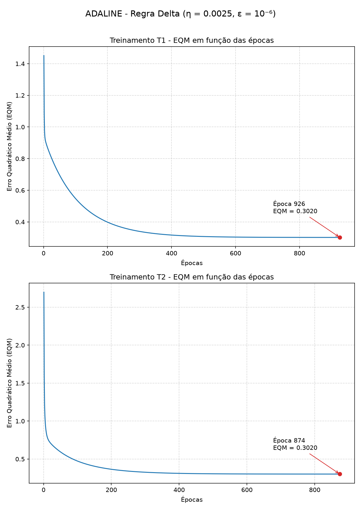

## Questão 2 – Resultados dos treinamentos

Taxa de aprendizagem η = 0,0025 e precisão ε = 10⁻⁶. Os pesos iniciais foram sorteados entre 0 e 1, com o gerador de números aleatórios reiniciado com uma semente diferente em cada treinamento (sementes 1 a 5).

| Treinamento | Semente | w0 inicial | w1 inicial | w2 inicial | w3 inicial | w4 inicial | w0 final | w1 final | w2 final | w3 final | w4 final | Nº de Épocas |
|:-----------:|:-------:|:----------:|:----------:|:----------:|:----------:|:----------:|:--------:|:--------:|:--------:|:--------:|:--------:|:------------:|
| 1º (T1) | 1 | 0.5118 | 0.9505 | 0.1442 | 0.9486 | 0.3118 | -1.8132 | 1.3129 | 1.6424 | -0.4276 | -1.1778 | 926 |
| 2º (T2) | 2 | 0.2616 | 0.2985 | 0.8142 | 0.0919 | 0.6001 | -1.8130 | 1.3128 | 1.6422 | -0.4277 | -1.1777 | 874 |
| 3º (T3) | 3 | 0.0856 | 0.2368 | 0.8013 | 0.5822 | 0.0941 | -1.8130 | 1.3129 | 1.6423 | -0.4276 | -1.1778 | 874 |
| 4º (T4) | 4 | 0.9431 | 0.5113 | 0.9762 | 0.0808 | 0.6074 | -1.8131 | 1.3129 | 1.6423 | -0.4277 | -1.1778 | 905 |
| 5º (T5) | 5 | 0.8050 | 0.8079 | 0.5153 | 0.2858 | 0.0539 | -1.8130 | 1.3129 | 1.6423 | -0.4276 | -1.1778 | 904 |

Os cinco treinamentos convergiram para um erro quadrático médio (EQM) final de aproximadamente 0,302.

## Questão 3 – Gráficos do EQM por época (T1 e T2)

Nos dois treinamentos, o EQM cai rapidamente nas primeiras épocas e depois diminui cada vez mais devagar, até estabilizar em aproximadamente 0,302. O treinamento termina quando a variação do EQM entre duas épocas consecutivas fica menor ou igual à precisão ε = 10⁻⁶, o que ocorreu na época 926 para o T1 e na época 874 para o T2. Embora os dois partam de valores de EQM diferentes, por causa dos pesos iniciais distintos, ambos chegam ao mesmo valor final.

## Questão 4 – Classificação dos sinais

Convenção: **-1 = válvula A** e **+1 = válvula B**.

| Amostra | x1 | x2 | x3 | x4 | y (T1) | y (T2) | y (T3) | y (T4) | y (T5) | Válvula |
|:-------:|:--:|:--:|:--:|:--:|:------:|:------:|:------:|:------:|:------:|:-------:|
| 1  | 0.9694  | 0.6909  | 0.4334 | 3.4965  | -1 | -1 | -1 | -1 | -1 | A |
| 2  | 0.5427  | 1.3832  | 0.6390 | 4.0352  | -1 | -1 | -1 | -1 | -1 | A |
| 3  | 0.6081  | -0.9196 | 0.5925 | 0.1016  | +1 | +1 | +1 | +1 | +1 | B |
| 4  | -0.1618 | 0.4694  | 0.2030 | 3.0117  | -1 | -1 | -1 | -1 | -1 | A |
| 5  | 0.1870  | -0.2578 | 0.6124 | 1.7749  | -1 | -1 | -1 | -1 | -1 | A |
| 6  | 0.4891  | -0.5276 | 0.4378 | 0.6439  | +1 | +1 | +1 | +1 | +1 | B |
| 7  | 0.3777  | 2.0149  | 0.7423 | 3.3932  | +1 | +1 | +1 | +1 | +1 | B |
| 8  | 1.1498  | -0.4067 | 0.2469 | 1.5866  | +1 | +1 | +1 | +1 | +1 | B |
| 9  | 0.9325  | 1.0950  | 1.0359 | 3.3591  | +1 | +1 | +1 | +1 | +1 | B |
| 10 | 0.5060  | 1.3317  | 0.9222 | 3.7174  | -1 | -1 | -1 | -1 | -1 | A |
| 11 | 0.0497  | -2.0656 | 0.6124 | -0.6585 | -1 | -1 | -1 | -1 | -1 | A |
| 12 | 0.4004  | 3.5369  | 0.9766 | 5.3532  | +1 | +1 | +1 | +1 | +1 | B |
| 13 | -0.1874 | 1.3343  | 0.5374 | 3.2189  | -1 | -1 | -1 | -1 | -1 | A |
| 14 | 0.5060  | 1.3317  | 0.9222 | 3.7174  | -1 | -1 | -1 | -1 | -1 | A |
| 15 | 1.6375  | -0.7911 | 0.7537 | 0.5515  | +1 | +1 | +1 | +1 | +1 | B |

Os sinais 1, 2, 4, 5, 10, 11, 13 e 14 devem ser encaminhados para a **válvula A**, e os sinais 3, 6, 7, 8, 9, 12 e 15 para a **válvula B**. Os cinco treinamentos produziram exatamente a mesma classificação para todos os sinais, o que é esperado, já que os pesos finais obtidos são praticamente idênticos.

## Questão 5 – Por que os pesos finais são praticamente iguais?

Porque a Regra Delta busca os pesos que minimizam o erro quadrático médio, e o EQM do ADALINE é uma função quadrática dos pesos, com formato de "tigela" e um único ponto de mínimo. Os pesos iniciais aleatórios mudam apenas o ponto de partida: alguns treinamentos começam mais longe do mínimo e precisam de mais épocas para chegar até ele, outros começam mais perto e precisam de menos. Mas todos descem até o mesmo ponto mínimo, e por isso os pesos finais são praticamente os mesmos, assim como o EQM final (≈ 0,302). As pequenas diferenças na quarta casa decimal existem porque o treinamento para quando a variação do EQM fica menor que ε = 10⁻⁶, um pouco antes de atingir o mínimo exato.