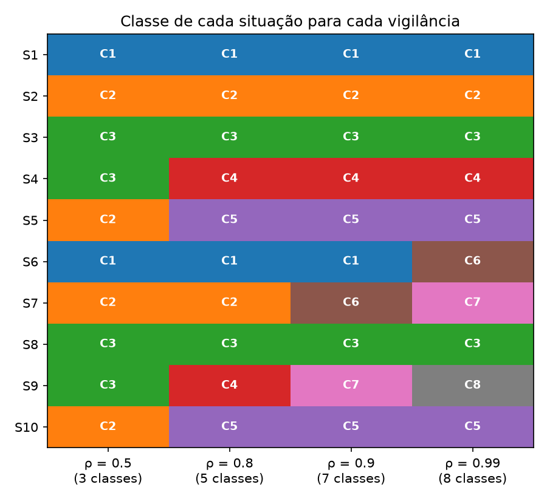
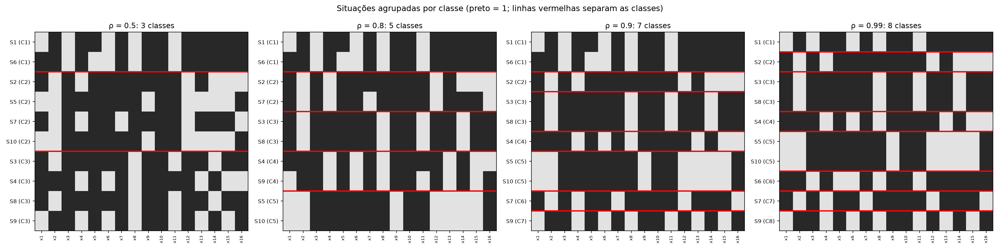
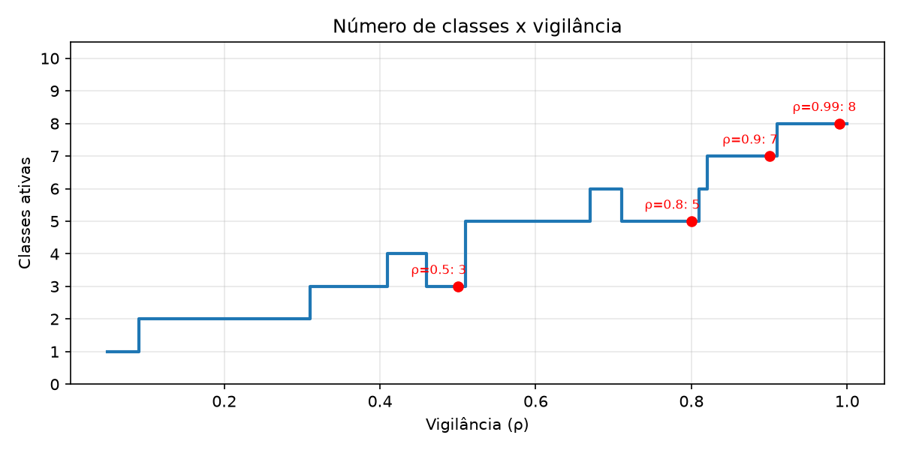

# Trabalho – Rede ART-1 (Agrupamento de Situações do Processo)

**Aluno:** João Pedro Marques Lopes Padilha

---

## Rede implementada

A rede recebe 16 entradas binárias (x₁ a x₁₆). Os neurônios de saída (classes) são criados à medida que a rede precisa.

**Pesos de cada neurônio novo:**

```
top-down   W_b = 1                (todos os 16 pesos)
bottom-up  W_f = 1 / (1 + 16)
```

**Para cada situação x:**

1. **Escolha do vencedor.** Cada neurônio habilitado calcula u_j = W_f[j] · x, e vence o de maior u_j.
2. **Teste de vigilância.**
   ```
   R = (W_b[k] · x) / Σx
   ```
   - Se R ≥ ρ, há ressonância e o vencedor aprende a situação.
   - Se R < ρ, o vencedor é desabilitado e volta-se ao passo 1.
   - Se nenhum neurônio passa no teste, cria-se uma classe nova.
3. **Aprendizado do vencedor k:**
   ```
   W_b[k] ← W_b[k] AND x
   W_f[k] ← (W_b[k] AND x) / (0,5 + Σ(W_b[k] AND x))
   ```

As 10 situações foram apresentadas em ordem, repetindo os ciclos até nenhuma mudar de classe.

Ao final, o vetor top-down W_b de cada classe guarda as variáveis em 1 que são **comuns a todas as situações daquela classe**. Ele funciona como o "padrão de falha" característico do grupo.

---

## Resultados

| Vigilância (ρ) | Classes ativas | Agrupamentos |
|:---:|:---:|---|
| **0,5** | **3** | {S1, S6} · {S2, S5, S7, S10} · {S3, S4, S8, S9} |
| **0,8** | **5** | {S1, S6} · {S2, S7} · {S3, S8} · {S4, S9} · {S5, S10} |
| **0,9** | **7** | {S1, S6} · {S2} · {S3, S8} · {S4} · {S5, S10} · {S7} · {S9} |
| **0,99** | **8** | {S1} · {S2} · {S3, S8} · {S4} · {S5, S10} · {S6} · {S7} · {S9} |



### ρ = 0,5 → 3 classes ativas

| Classe | Situações | Variáveis em 1 comuns ao grupo (W_b) |
|:---:|---|---|
| 1 | S1, S6 | x2, x4, x7, x9, x10, x12, x13, x14, x15, x16 |
| 2 | S2, S5, S7, S10 | x3, x5, x6, x8, x10, x11 |
| 3 | S3, S4, S8, S9 | x3, x5, x7, x9, x10, x12 |

A rede chegou a criar 4 neurônios. Porém, um deles ficou sem nenhuma situação ao final dos ciclos, porque as situações migraram para outros neurônios. Por isso, há 3 classes ativas.

### ρ = 0,8 → 5 classes ativas

| Classe | Situações | Variáveis em 1 comuns ao grupo (W_b) |
|:---:|---|---|
| 1 | S1, S6 | x2, x4, x7, x9, x10, x12, x13, x14, x15, x16 |
| 2 | S2, S7 | x1, x3, x5, x6, x8, x9, x10, x11, x13 |
| 3 | S3, S8 | x1, x3, x4, x5, x6, x7, x9, x10, x12, x13, x15, x16 |
| 4 | S4, S9 | x2, x3, x5, x7, x9, x10, x12, x14 |
| 5 | S5, S10 | x3, x4, x5, x6, x7, x8, x10, x11, x16 |

### ρ = 0,9 → 7 classes ativas

| Classe | Situações |
|:---:|---|
| 1 | S1, S6 |
| 2 | S2 |
| 3 | S3, S8 |
| 4 | S4 |
| 5 | S5, S10 |
| 6 | S7 |
| 7 | S9 |

### ρ = 0,99 → 8 classes ativas

| Classe | Situações |
|:---:|---|
| 1 | S1 |
| 2 | S2 |
| 3 | S3, S8 |
| 4 | S4 |
| 5 | S5, S10 |
| 6 | S6 |
| 7 | S7 |
| 8 | S9 |



---

## Análise

**A vigilância controla o quão "parecidas" as situações precisam ser para ficarem juntas.**

- Com **ρ baixo**, a rede aceita situações que compartilham apenas parte das variáveis. Isso gera poucas classes e um diagnóstico mais genérico.
- Com **ρ alto**, a rede exige quase igualdade. Isso gera muitas classes e um diagnóstico mais específico.

**Nos quatro valores pedidos, os agrupamentos se refinam de forma hierárquica.** Cada aumento de ρ apenas divide grupos existentes, sem misturar situações de grupos diferentes:

```
ρ = 0,5   {S2,S5,S7,S10}               {S3,S4,S8,S9}             {S1,S6}
              ↓                             ↓
ρ = 0,8   {S2,S7}   {S5,S10}           {S3,S8}   {S4,S9}         {S1,S6}
              ↓                                      ↓
ρ = 0,9   {S2} {S7} {S5,S10}           {S3,S8}   {S4} {S9}       {S1,S6}
                                                                    ↓
ρ = 0,99  {S2} {S7} {S5,S10}           {S3,S8}   {S4} {S9}       {S1} {S6}
```

**Os pontos em que cada par se separa podem ser calculados pelo teste de vigilância.** R é a fração das variáveis em 1 da situação que também está em 1 no protótipo do grupo:

| Par | Variáveis em 1 em comum | R de cada situação | Separa a partir de |
|---|:---:|---|:---:|
| S4 e S9 | 8 | S4: 8/10 = 0,80 · S9: 8/9 = 0,89 | ρ = 0,81 |
| S2 e S7 | 9 | S2: 9/10 = 0,90 · S7: 9/11 = 0,82 | ρ = 0,82 |
| S1 e S6 | 10 | S1: 10/11 = 0,91 · S6: 10/11 = 0,91 | ρ = 0,91 |

**Com ρ = 0,99 há 8 classes, e não 10.** As situações S3 e S8 são idênticas, assim como S5 e S10. Para elas, R = 1 sempre, e nenhuma vigilância consegue separá-las. Na prática, isso indica que o processo passou duas vezes exatamente pelo mesmo estado, e o diagnóstico de manutenção seria o mesmo nos dois casos.

**ρ = 0,5 está exatamente no limite.** No grupo {S3, S4, S8, S9}, o protótipo tem 6 variáveis em 1, e S3 e S8 têm 12. Assim, R = 6/12 = 0,5, e elas só permanecem no grupo porque o teste usa R ≥ ρ. A varredura confirma: o agrupamento em 3 classes vale para ρ entre 0,46 e 0,50, e com ρ = 0,51 a rede já forma 5 classes.



**O número de classes não cresce sempre de forma regular com ρ.** Por exemplo, há 4 classes em ρ = 0,45 e 3 em 0,46, e 6 classes em ρ = 0,70 e 5 em 0,71. Isso acontece porque, na ART-1, o resultado depende da ordem de apresentação das situações e de qual neurônio ganha primeiro. Com uma vigilância um pouco diferente, uma situação pode ser aceita por outro neurônio no início, e isso muda os protótipos formados depois. Nos quatro valores pedidos no enunciado, porém, o comportamento foi o esperado: 3 → 5 → 7 → 8 classes.
