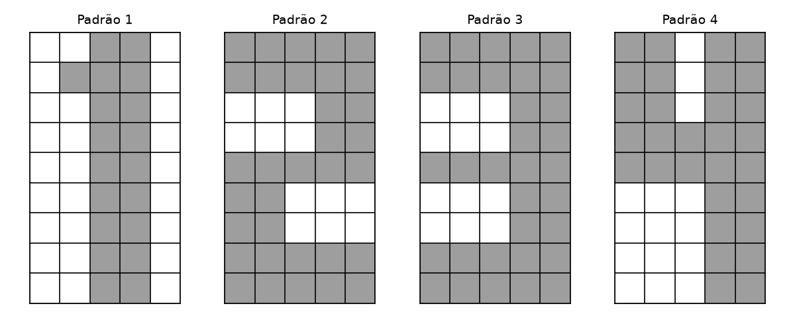
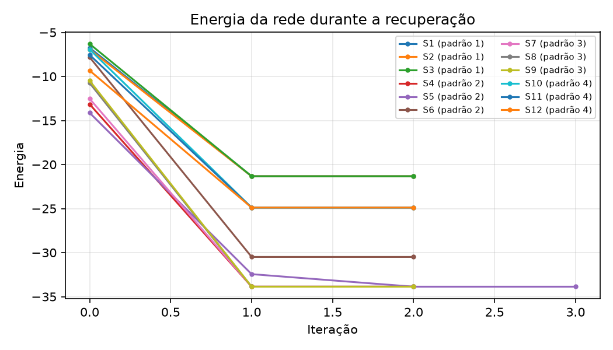
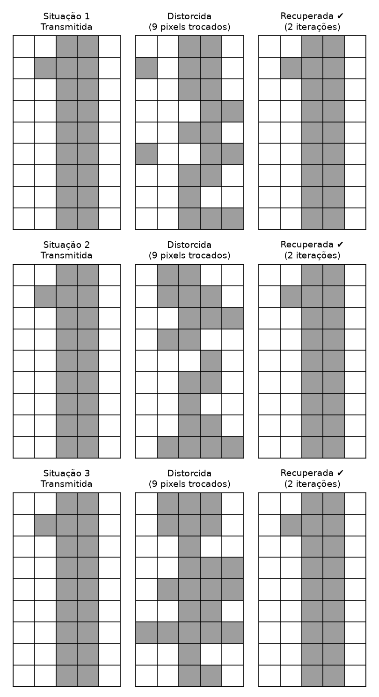
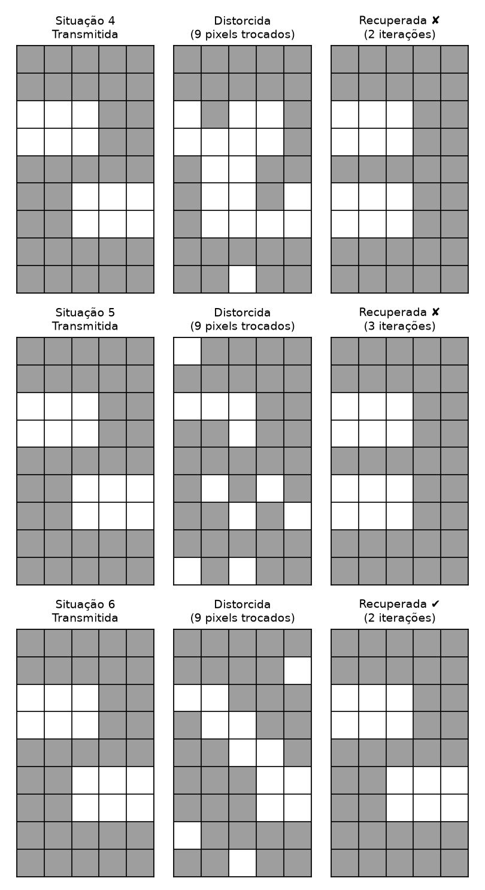
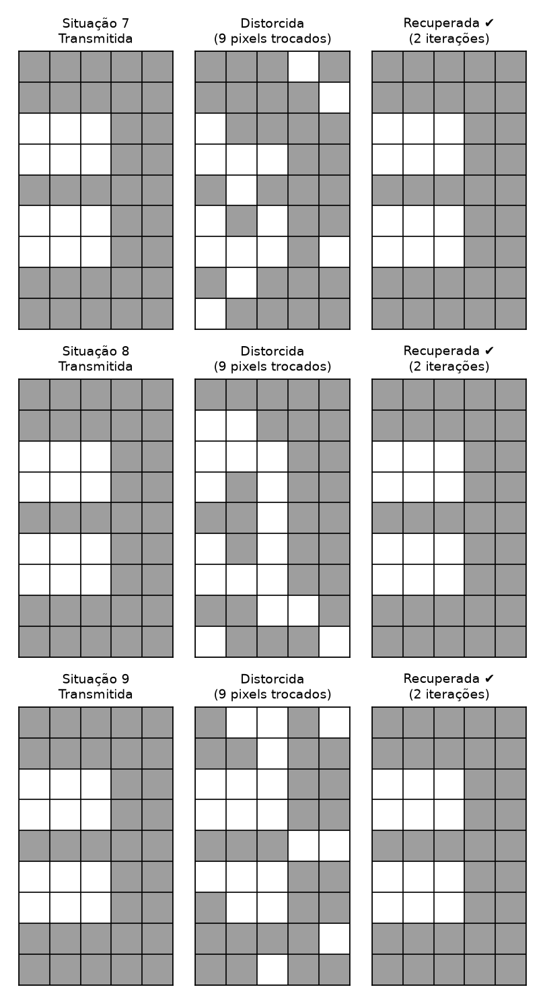
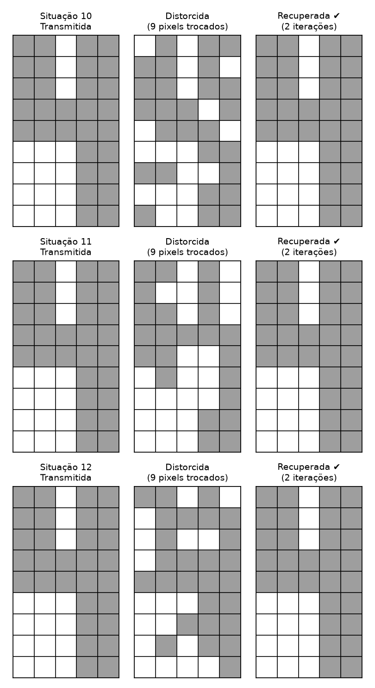
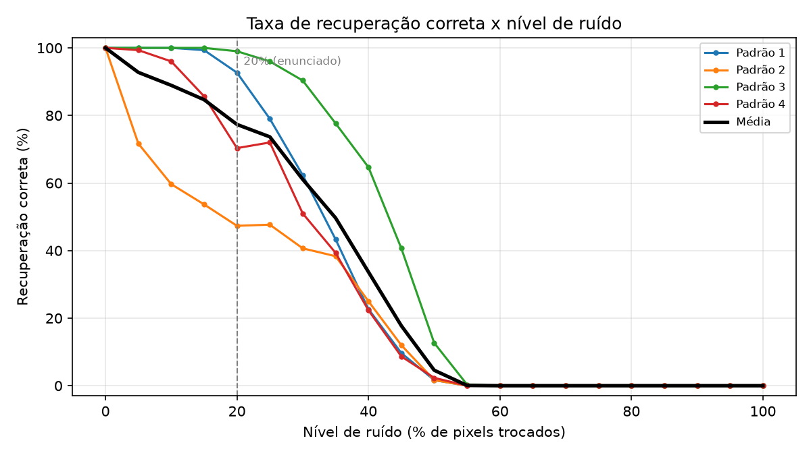
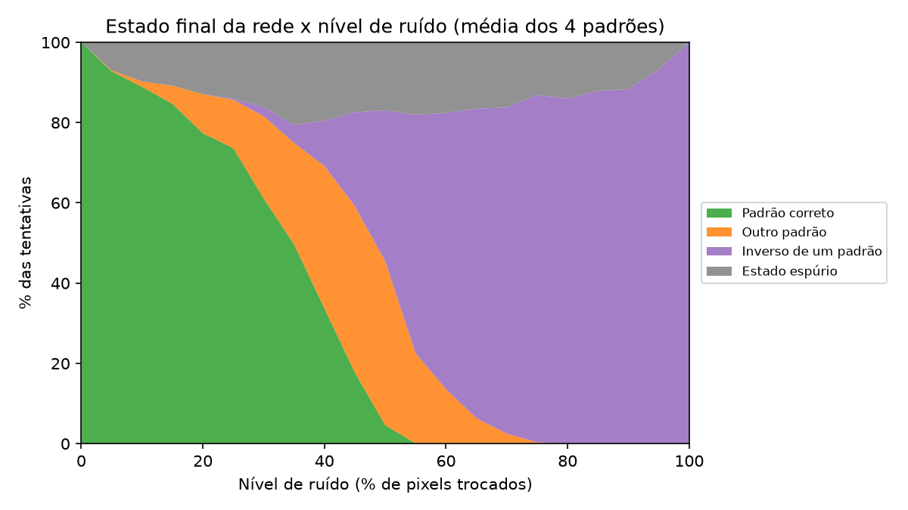
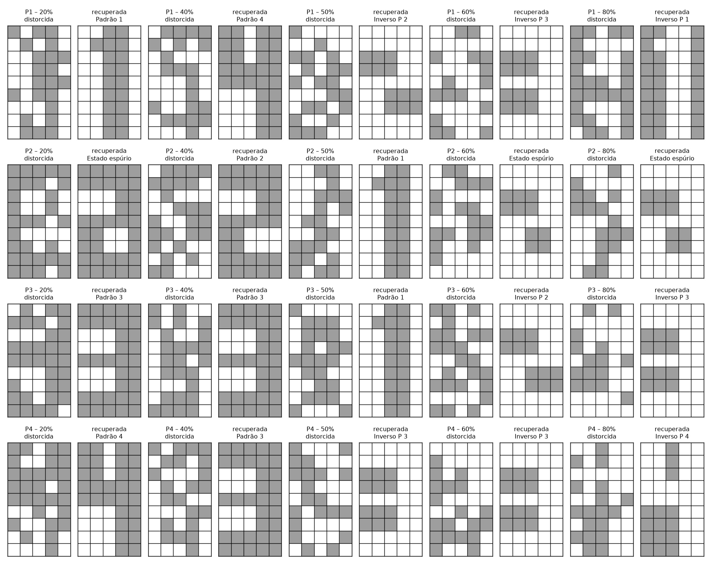

# Trabalho – Rede de Hopfield (Memória Associativa)

**Aluno:** João Pedro Marques Lopes Padilha

---

## Rede implementada

- **Tamanho:** 45 neurônios, um para cada pixel da imagem de 9 × 5. Pixel branco vale −1 e pixel escuro vale +1.
- **Pesos:** calculados pela regra do produto externo, com a diagonal zerada:

```
W = (1/45) · Σ z·zᵀ − (4/45) · I
```

- **Ativação:** tangente hiperbólica com β muito grande (β = 1000), que na prática funciona como a função sinal:

```
v_i ← tanh(β · u_i),   u_i = Σ_j W_ij · v_j
```

- **Estabilidade dos padrões:** os 4 padrões armazenados são estáveis. Quando apresentados sem ruído, a rede permanece neles.



---

## 1 e 2. Simulação das 12 transmissões

Em cada situação, 9 dos 45 pixels (20%) foram trocados aleatoriamente (−1 ↔ +1). A imagem distorcida foi apresentada à rede, que atualizou os neurônios até a saída parar de mudar.

| Situação | Padrão transmitido | Pixels corrompidos | Iterações | Imagem recuperada | Resultado |
|:---:|:---:|:---:|:---:|:---:|:---:|
| 1 | 1 | 9 (20%) | 2 | Padrão 1 | ✔ |
| 2 | 1 | 9 (20%) | 2 | Padrão 1 | ✔ |
| 3 | 1 | 9 (20%) | 2 | Padrão 1 | ✔ |
| 4 | 2 | 9 (20%) | 2 | Padrão 3 | ✘ |
| 5 | 2 | 9 (20%) | 3 | Padrão 3 | ✘ |
| 6 | 2 | 9 (20%) | 2 | Padrão 2 | ✔ |
| 7 | 3 | 9 (20%) | 2 | Padrão 3 | ✔ |
| 8 | 3 | 9 (20%) | 2 | Padrão 3 | ✔ |
| 9 | 3 | 9 (20%) | 2 | Padrão 3 | ✔ |
| 10 | 4 | 9 (20%) | 2 | Padrão 4 | ✔ |
| 11 | 4 | 9 (20%) | 2 | Padrão 4 | ✔ |
| 12 | 4 | 9 (20%) | 2 | Padrão 4 | ✔ |

**Resultado: a rede recuperou a imagem correta em 10 das 12 situações.**

**As duas falhas (situações 4 e 5)** ocorreram com o padrão 2: em ambas, a rede convergiu para o padrão 3. Os dois diferem em apenas 8 dos 45 pixels, nas linhas 6 e 7 da imagem. Por isso, o ruído pode deixar a imagem distorcida mais próxima do padrão 3 do que do 2. Note que a rede não produziu uma imagem "suja": ela entregou outra imagem limpa e válida, só que a errada.

**Velocidade de convergência:** em todas as situações, a rede estabilizou em 2 ou 3 iterações. A energia cai a cada atualização até atingir um mínimo, que é o estado em que a rede para.



### Padrão 1


### Padrão 2


### Padrão 3


### Padrão 4


---

## 3. O que acontece quando o ruído aumenta excessivamente

Para medir o efeito do ruído, cada padrão foi corrompido 300 vezes em cada nível de ruído, de 0% a 100%. Em cada tentativa, foi anotado em qual estado a rede terminou.

| Ruído | Pixels trocados | Padrão correto | Outro padrão | Inverso de um padrão | Estado espúrio |
|:---:|:---:|:---:|:---:|:---:|:---:|
| 0% | 0 | 100,0% | 0,0% | 0,0% | 0,0% |
| 10% | 4 | 88,9% | 1,3% | 0,0% | 9,8% |
| 20% | 9 | 77,3% | 9,8% | 0,0% | 12,9% |
| 30% | 14 | 61,1% | 20,5% | 2,3% | 16,1% |
| 40% | 18 | 33,7% | 35,5% | 11,3% | 19,5% |
| 50% | 22 | 4,6% | 40,8% | 37,7% | 16,9% |
| 60% | 27 | 0,0% | 13,6% | 68,8% | 17,6% |
| 80% | 36 | 0,0% | 0,0% | 86,0% | 14,0% |
| 100% | 45 | 0,0% | 0,0% | 100,0% | 0,0% |





A rede de Hopfield sempre converge para um ponto de mínimo da sua função de energia. A memória funciona porque cada padrão armazenado é um desses mínimos e tem ao redor uma **bacia de atração**: imagens próximas o suficiente "rolam" até ele. Quanto mais ruído, mais a imagem se afasta do padrão original, até sair da bacia de atração dele e cair em outra. O comportamento muda em quatro faixas:

- **Ruído baixo (até cerca de 15%).** A imagem distorcida ainda está dentro da bacia do padrão original, e a rede o recupera na maioria dos casos (85% a 100%).

- **Ruído moderado (20% a 40%).** A rede começa a convergir para **outro padrão armazenado** ou para **estados espúrios**. Estados espúrios são mínimos de energia que não foram armazenados, geralmente misturas de padrões.
  - Os padrões 2 e 3 coincidem em 37 dos 45 pixels, e o 3 e o 4 em 32. Por isso suas bacias de atração ficam próximas, e poucos pixels trocados bastam para "pular" de uma para a outra.
  - Mesmo com 20% de ruído, o padrão 2 é recuperado em apenas 47% das vezes. O padrão 3, por sua vez, é recuperado em 99%.

- **Ruído próximo de 50%.** A imagem distorcida fica igualmente distante do padrão original e do seu inverso; na prática, perdeu toda a informação. A recuperação correta cai para 4,6%.

- **Ruído acima de 50%.** A rede passa a convergir para o **inverso** de um padrão, ou seja, a mesma imagem com as cores trocadas.
  - Isso acontece porque a energia da rede, E(v) = −½·vᵀWv, é a mesma para v e −v. Assim, se z é um ponto estável, −z também é.
  - Com mais da metade dos pixels trocados, a imagem fica mais parecida com o inverso do que com o original.
  - No extremo de 100%, a entrada é exatamente o inverso do padrão, e a rede permanece nela.



**Conclusão:** com ruído excessivo, a rede continua convergindo para uma imagem "limpa" e estável, mas que não é a transmitida. Ela pode ser outro padrão, uma mistura (estado espúrio) ou o negativo da imagem. A memória associativa só é confiável enquanto o ruído mantém a imagem dentro da bacia de atração do padrão correto. Neste problema, isso vale até cerca de 15% a 20%, e menos ainda para os padrões parecidos entre si (2 e 3).
