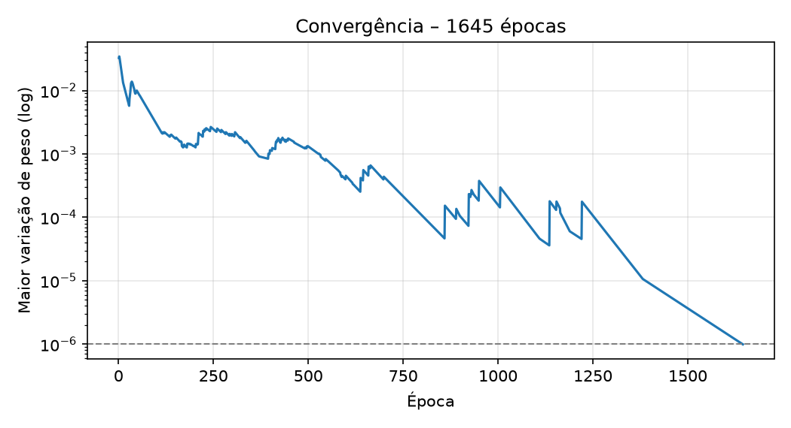
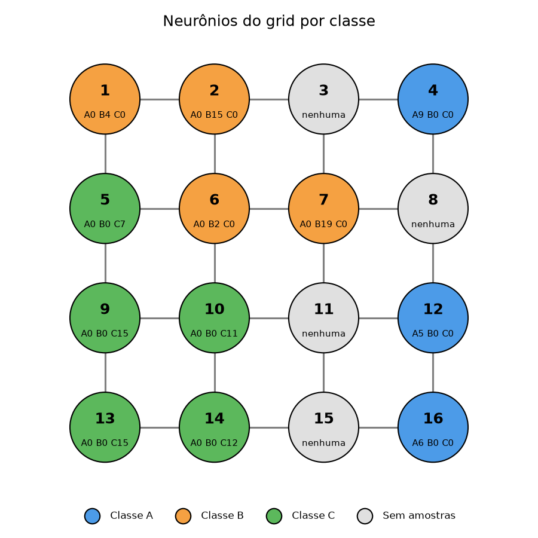
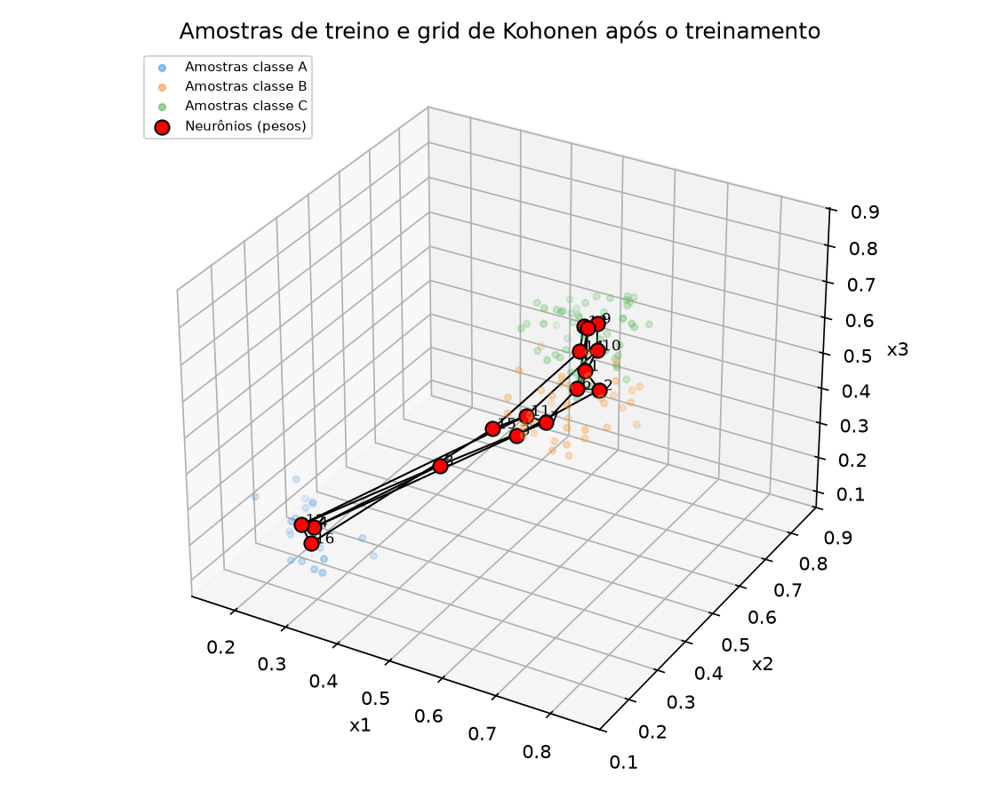
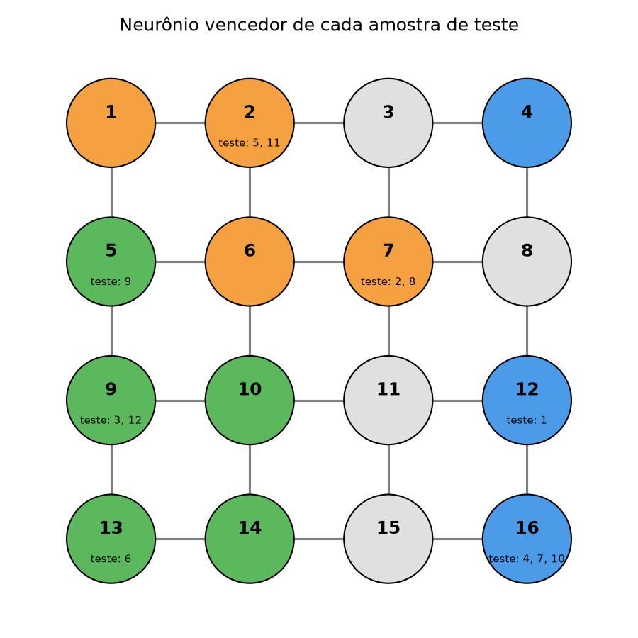

# Trabalho – Rede de Kohonen (Mapa Auto-Organizável)

**Aluno:** João Pedro Marques Lopes Padilha

---

## Treinamento

Parâmetros da rede:

| Parâmetro | Valor |
|---|---|
| Neurônios (N1) | 16, em grid 4 × 4 |
| Taxa de aprendizado (η) | 0,001 |
| Raio de vizinhança | 1 (só os neurônios ligados no diagrama do grid) |
| Pesos iniciais | As 16 primeiras amostras de treinamento |

Regras de ajuste, aplicadas a cada amostra apresentada:

```
vencedor j:     w_j ← w_j + η · (x − w_j)
vizinhos v:     w_v ← w_v + (η/2) · (x − w_v)
```

O vencedor é o neurônio cujo vetor de pesos tem a menor distância euclidiana até a amostra.

**Convergência:** a rede convergiu em **1645 épocas**. O critério de parada foi a maior variação de peso numa época ficar abaixo de 10⁻⁶.



---

## 1. Neurônios que respondem a cada classe

Depois do treinamento, as 120 amostras foram apresentadas novamente à rede, e foi registrado o neurônio vencedor de cada uma:

| Classe | Amostras | Neurônios do grid | Amostras vencidas por cada neurônio |
|:---:|:---:|:---:|:---|
| **A** | 1 a 20 | **4, 12, 16** | 4 → 9 · 12 → 5 · 16 → 6 |
| **B** | 21 a 60 | **1, 2, 6, 7** | 1 → 4 · 2 → 15 · 6 → 2 · 7 → 19 |
| **C** | 61 a 120 | **5, 9, 10, 13, 14** | 5 → 7 · 9 → 15 · 10 → 11 · 13 → 15 · 14 → 12 |
| — | — | 3, 8, 11, 15 | Não venceram nenhuma amostra |

**Nenhum neurônio respondeu a mais de uma classe.** Cada neurônio ativo venceu amostras de uma única classe, ou seja, todos têm 100% de pureza.

**Os neurônios 3, 8, 11 e 15 não venceram nenhuma amostra.** Eles ficaram posicionados entre os grupos, como mostra a figura 3D, e formam uma faixa de transição no grid. Essa faixa separa a classe A (coluna da direita) das classes B (parte superior esquerda) e C (parte inferior esquerda).





---

## 2. Classificação das amostras

| Amostra | x₁ | x₂ | x₃ | Neurônio vencedor | Classe |
|:---:|:---:|:---:|:---:|:---:|:---:|
| 1 | 0,2471 | 0,1778 | 0,2905 | 12 | **A** |
| 2 | 0,8240 | 0,2223 | 0,7041 | 7 | **B** |
| 3 | 0,4960 | 0,7231 | 0,5866 | 9 | **C** |
| 4 | 0,2923 | 0,2041 | 0,2234 | 16 | **A** |
| 5 | 0,8118 | 0,2668 | 0,7484 | 2 | **B** |
| 6 | 0,4837 | 0,8200 | 0,4792 | 13 | **C** |
| 7 | 0,3248 | 0,2629 | 0,2375 | 16 | **A** |
| 8 | 0,7209 | 0,2116 | 0,7821 | 7 | **B** |
| 9 | 0,5259 | 0,6522 | 0,5957 | 5 | **C** |
| 10 | 0,2075 | 0,1669 | 0,1745 | 16 | **A** |
| 11 | 0,7830 | 0,3171 | 0,7888 | 2 | **B** |
| 12 | 0,5393 | 0,7510 | 0,5682 | 9 | **C** |

Cada amostra foi classificada pela classe do seu neurônio vencedor. Todas venceram em neurônios com classe definida.

**Conferência:** a classificação coincide, nas 12 amostras, com a classe cujo centro (média das amostras de treino) está mais próximo de cada uma.



---

## 3. Demonstração da regra "Norma Euclidiana"

Considere o neurônio vencedor j e uma amostra **x**. O erro quadrático entre o vetor de pesos do vencedor e a amostra é:

```
E = ½ · Σᵢ (w_ji − x_i)²
```

Queremos ajustar os pesos de modo a diminuir E. Pelo **gradiente descendente**, cada peso deve andar no sentido contrário ao gradiente:

```
Δw_ji = −η · ∂E/∂w_ji
```

**Cálculo da derivada.** Na soma, só o termo i depende de w_ji. Os demais são constantes em relação a ele:

```
∂E/∂w_ji = ∂/∂w_ji [ ½ · (w_ji − x_i)² ]
         = ½ · 2 · (w_ji − x_i) · 1
         = (w_ji − x_i)
```

**Substituindo na regra do gradiente:**

```
Δw_ji = −η · (w_ji − x_i) = η · (x_i − w_ji)
```

**Para todos os pesos do neurônio j, na forma vetorial:**

```
w_j ← w_j + η · (x − w_j)
```

Essa é exatamente a regra de ajuste "Norma Euclidiana" da rede de Kohonen. ∎

**Interpretação:**

- O termo (x − w_j) é o vetor que vai do peso atual até a amostra. Com 0 < η < 1, o novo w_j fica no segmento entre w_j e x, ou seja, o neurônio vencedor se aproxima da amostra.
- A cada ajuste, a distância é multiplicada por (1 − η):

```
‖x − w_j(novo)‖ = (1 − η) · ‖x − w_j‖
```

- Assim, E diminui a cada passo. Ao longo do treinamento, cada neurônio converge para o centro do grupo de amostras que ele vence.
- O critério que escolhe o vencedor é minimizar ‖x − w_j‖, que é a própria raiz de 2E. Ou seja, a regra de ajuste e a escolha do vencedor otimizam a mesma função de erro.
