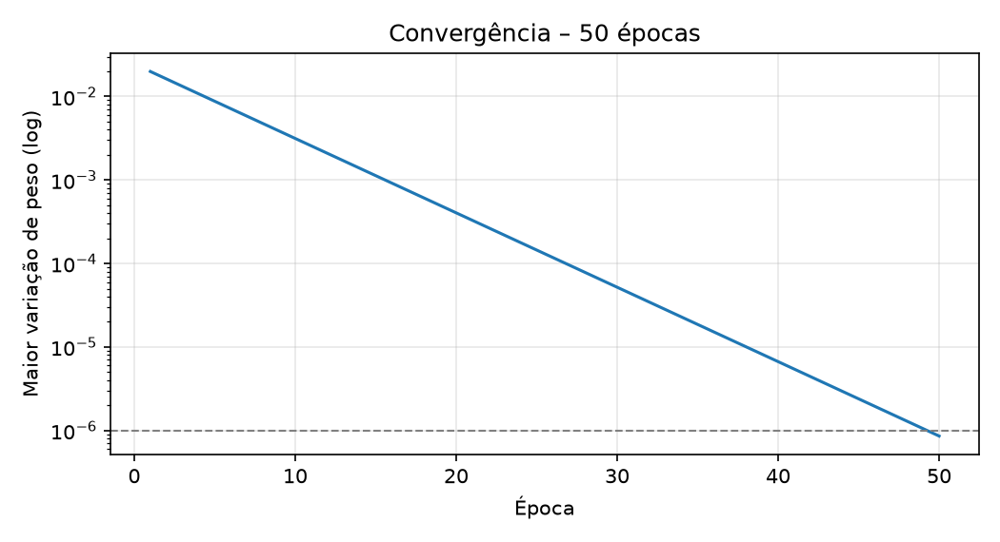
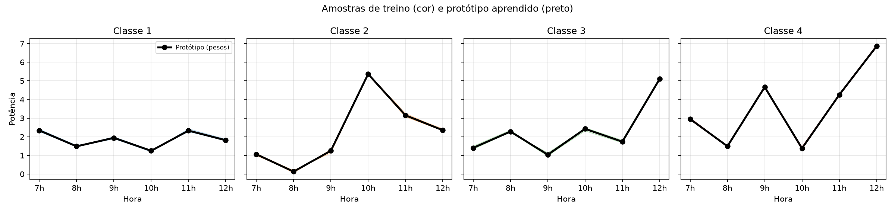
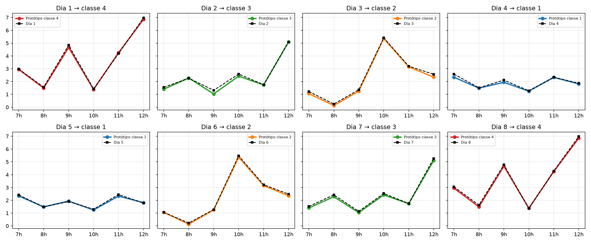

# Trabalho – Rede LVQ-1 (Classificação de Perfis de Potência)

**Aluno:** João Pedro Marques Lopes Padilha

---

## Rede implementada

| Item | Valor |
|---|---|
| Entradas | 6: potência medida das 7h às 12h |
| Neurônios | 4, um protótipo para cada classe de perfil |
| Taxa de aprendizagem (γ) | 0,05 |
| Pesos iniciais | Primeira amostra de cada classe (amostras 1, 5, 9 e 13) |
| Critério de parada | Maior variação de peso numa época < 10⁻⁶ |

A cada amostra **x** apresentada, o neurônio vencedor j é aquele com a menor distância euclidiana até **x**. Seus pesos são ajustados assim:

```
classe do vencedor = classe de x   →   w_j ← w_j + γ · (x − w_j)    (aproxima)
classe do vencedor ≠ classe de x   →   w_j ← w_j − γ · (x − w_j)    (afasta)
```

---

## Treinamento

A rede convergiu em **50 épocas**. Em nenhuma época um protótipo venceu uma amostra de outra classe: os 4 perfis são bem separados entre si. Por isso, todos os ajustes foram de aproximação, e cada protótipo convergiu para o "perfil médio" da sua classe.



### Protótipos aprendidos (pesos finais)

| Neurônio / Classe | 7h | 8h | 9h | 10h | 11h | 12h |
|:---:|:---:|:---:|:---:|:---:|:---:|:---:|
| 1 | 2,3397 | 1,4859 | 1,9419 | 1,2469 | 2,3296 | 1,8133 |
| 2 | 1,0635 | 0,1319 | 1,2480 | 5,3618 | 3,1513 | 2,3526 |
| 3 | 1,4049 | 2,2791 | 1,0377 | 2,4234 | 1,7355 | 5,0966 |
| 4 | 2,9496 | 1,4917 | 4,6638 | 1,3822 | 4,2506 | 6,8533 |

Cada protótipo representa o perfil típico de demanda de uma classe:

- **Classe 1:** demanda baixa e estável, entre 1,2 e 2,3 durante toda a manhã.
- **Classe 2:** demanda mínima às 8h (0,13) e pico às 10h (5,36).
- **Classe 3:** demanda moderada até as 11h e salto às 12h (5,10).
- **Classe 4:** demanda alta e oscilante, com picos às 9h (4,66) e às 12h (6,85).



**Verificação:** quando as 16 amostras de treinamento são reapresentadas à rede treinada, **todas (16 de 16)** são classificadas na classe correta.

---

## Classificação dos dias de teste

A classe de cada dia é a do protótipo mais próximo (menor distância euclidiana):

| Dia | 7h | 8h | 9h | 10h | 11h | 12h | Dist. classe 1 | Dist. classe 2 | Dist. classe 3 | Dist. classe 4 | **Classe** |
|:---:|:---:|:---:|:---:|:---:|:---:|:---:|:---:|:---:|:---:|:---:|:---:|
| 1 | 2,9817 | 1,5656 | 4,8391 | 1,4311 | 4,1916 | 6,9718 | 6,2388 | 7,5167 | 5,2896 | **0,2391** | **4** |
| 2 | 1,5537 | 2,2615 | 1,3169 | 2,5873 | 1,7570 | 5,0958 | 3,8091 | 4,6848 | **0,3574** | 4,9499 | **3** |
| 3 | 1,2240 | 0,2445 | 1,3595 | 5,4192 | 3,2027 | 2,5675 | 4,6759 | **0,3209** | 4,6690 | 7,1564 | **2** |
| 4 | 2,5828 | 1,5146 | 2,1119 | 1,2859 | 2,3414 | 1,8695 | **0,3060** | 4,7401 | 3,8989 | 5,9279 | **1** |
| 5 | 2,4168 | 1,4857 | 1,8959 | 1,3013 | 2,4500 | 1,7868 | **0,1620** | 4,6242 | 3,8877 | 6,0715 | **1** |
| 6 | 1,0604 | 0,2276 | 1,2806 | 5,4732 | 3,2133 | 2,4839 | 4,7696 | **0,2091** | 4,7642 | 7,3155 | **2** |
| 7 | 1,5246 | 2,4254 | 1,1353 | 2,5325 | 1,7569 | 5,2640 | 4,0107 | 4,8899 | **0,2927** | 5,0418 | **3** |
| 8 | 3,0565 | 1,6259 | 4,7743 | 1,3654 | 4,2904 | 6,9808 | 6,2544 | 7,5715 | 5,3211 | **0,2445** | **4** |

**As classificações são confiáveis.** Em todos os dias, a distância ao protótipo vencedor ficou entre 0,16 e 0,36, enquanto a distância ao segundo protótipo mais próximo foi de pelo menos 3,8. Ou seja, cada dia é muito mais parecido com um perfil do que com qualquer outro, e não houve nenhum caso ambíguo.



**Resumo:**

| Classe | Dias |
|:---:|:---:|
| 1 | 4 e 5 |
| 2 | 3 e 6 |
| 3 | 2 e 7 |
| 4 | 1 e 8 |
