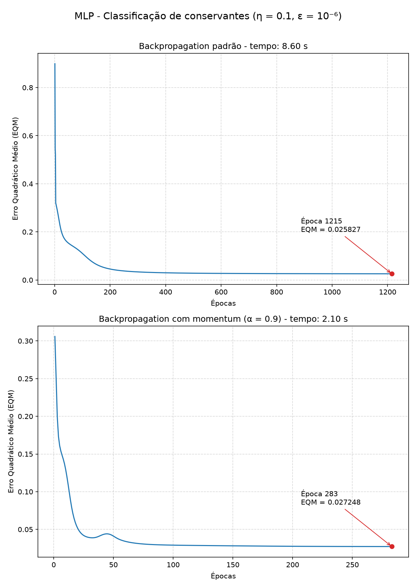

## Questão 1 – Treinamento com backpropagation padrão

Rede Perceptron Multicamadas com 4 entradas (x1, x2, x3, x4), 15 neurônios na camada escondida e 3 neurônios na camada de saída (y1, y2, y3), treinada com os 130 padrões do conjunto de treinamento.

- Função de ativação: logística (sigmoide), em todos os neurônios.
- Taxa de aprendizagem: η = 0,1.
- Precisão: ε = 10⁻⁶. O treinamento termina quando |EQM_atual − EQM_anterior| ≤ ε.
- Pesos iniciais: valores aleatórios entre 0 e 1 nas matrizes W1 (15 × 5, incluindo o bias) e W2 (3 × 16, incluindo o bias), gerados com a semente 1.
- Regra de ajuste: W ← W + η · δ · entrada.

## Questão 2 – Treinamento com backpropagation com momentum

O segundo treinamento partiu exatamente das mesmas matrizes de pesos iniciais do item anterior, com η = 0,1, ε = 10⁻⁶ e fator de momentum α = 0,9. A regra de ajuste passa a considerar a variação anterior dos pesos:

W(t+1) = W(t) + α · (W(t) − W(t−1)) + η · δ · entrada

| Método | EQM final | Número de Épocas | Tempo de processamento |
|:------:|:---------:|:----------------:|:----------------------:|
| Backpropagation padrão | 0.025827 | 1215 | 8,60 s |
| Backpropagation com momentum | 0.027248 | 283 | 2,10 s |



O backpropagation com momentum convergiu com cerca de 4,3 vezes menos épocas (283 contra 1215) e em cerca de 4,1 vezes menos tempo (2,10 s contra 8,60 s), atingindo um EQM final praticamente igual ao do método padrão. Isso ocorre porque o termo de momentum dá "inércia" ao ajuste dos pesos: quando as correções seguem na mesma direção por várias iterações, os passos ficam maiores, o que acelera a descida nas regiões mais planas da superfície de erro. No gráfico do momentum também aparece uma pequena oscilação por volta da época 40, efeito típico dessa inércia, em que os pesos ultrapassam levemente o mínimo e depois retornam.

## Questão 3 – Pós-processamento das saídas

A rede fornece saídas reais entre 0 e 1, por causa da função logística. Para obter o tipo de conservante, cada saída é convertida em inteiro pelo arredondamento simétrico:

- yᵢ_pós = 1, se yᵢ ≥ 0,5
- yᵢ_pós = 0, se yᵢ < 0,5

Rotina implementada em Python:

```python
def post_process(y):
    """Converte as saidas reais em inteiros: 1 se y_i >= 0.5, 0 se y_i < 0.5"""
    return (y >= 0.5).astype(int)
```

Exemplo: as saídas (0,9994; 0,0010; 0,0000) resultam em (1, 0, 0), ou seja, conservante tipo A. Esse pós-processamento é aplicado apenas no conjunto de teste. Durante o treinamento são usados os valores reais, pois o ajuste dos pesos depende da magnitude do erro.

## Questão 4 – Validação com o conjunto de teste

Uma amostra é considerada correta somente quando as três saídas pós-processadas coincidem com os valores desejados (d1, d2, d3).

### Rede treinada com backpropagation padrão

| Amostra | x1 | x2 | x3 | x4 | d1 | d2 | d3 | y1 pós | y2 pós | y3 pós | y1 | y2 | y3 |
|:-------:|:--:|:--:|:--:|:--:|:--:|:--:|:--:|:------:|:------:|:------:|:--:|:--:|:--:|
| 1  | 0.8622 | 0.7101 | 0.6236 | 0.7894 | 0 | 0 | 1 | 0 | 0 | 1 | 0.0000 | 0.0029 | 0.9970 |
| 2  | 0.2741 | 0.1552 | 0.1333 | 0.1516 | 1 | 0 | 0 | 1 | 0 | 0 | 0.9994 | 0.0010 | 0.0000 |
| 3  | 0.6772 | 0.8516 | 0.6543 | 0.7573 | 0 | 0 | 1 | 0 | 0 | 1 | 0.0000 | 0.0026 | 0.9974 |
| 4  | 0.2178 | 0.5039 | 0.6415 | 0.5039 | 0 | 1 | 0 | 0 | 1 | 0 | 0.0026 | 0.9863 | 0.0009 |
| 5  | 0.7260 | 0.7500 | 0.7007 | 0.4953 | 0 | 0 | 1 | 0 | 0 | 1 | 0.0000 | 0.0846 | 0.9319 |
| 6  | 0.2473 | 0.2941 | 0.4248 | 0.3087 | 1 | 0 | 0 | 1 | 0 | 0 | 0.9400 | 0.0616 | 0.0000 |
| 7  | 0.5682 | 0.5683 | 0.5054 | 0.4426 | 0 | 1 | 0 | 0 | 1 | 0 | 0.0009 | 0.9876 | 0.0022 |
| 8  | 0.6566 | 0.6715 | 0.4952 | 0.3951 | 0 | 1 | 0 | 0 | 1 | 0 | 0.0002 | 0.9803 | 0.0087 |
| 9  | 0.0705 | 0.4717 | 0.2921 | 0.2954 | 1 | 0 | 0 | 1 | 0 | 0 | 0.9740 | 0.0296 | 0.0000 |
| 10 | 0.1187 | 0.2568 | 0.3140 | 0.3037 | 1 | 0 | 0 | 1 | 0 | 0 | 0.9951 | 0.0058 | 0.0000 |
| 11 | 0.5673 | 0.7011 | 0.4083 | 0.5552 | 0 | 1 | 0 | 0 | 1 | 0 | 0.0002 | 0.9795 | 0.0086 |
| 12 | 0.3164 | 0.2251 | 0.3526 | 0.2560 | 1 | 0 | 0 | 1 | 0 | 0 | 0.9888 | 0.0122 | 0.0000 |
| 13 | 0.7884 | 0.9568 | 0.6825 | 0.6398 | 0 | 0 | 1 | 0 | 0 | 1 | 0.0000 | 0.0007 | 0.9992 |
| 14 | 0.9633 | 0.7850 | 0.6777 | 0.6059 | 0 | 0 | 1 | 0 | 0 | 1 | 0.0000 | 0.0017 | 0.9982 |
| 15 | 0.7739 | 0.8505 | 0.7934 | 0.6626 | 0 | 0 | 1 | 0 | 0 | 1 | 0.0000 | 0.0005 | 0.9995 |
| 16 | 0.4219 | 0.4136 | 0.1408 | 0.0940 | 1 | 0 | 0 | 1 | 0 | 0 | 0.9951 | 0.0066 | 0.0000 |
| 17 | 0.6616 | 0.4365 | 0.6597 | 0.8129 | 0 | 0 | 1 | 0 | 0 | 1 | 0.0000 | 0.3093 | 0.7073 |
| 18 | 0.7325 | 0.4761 | 0.3888 | 0.5683 | 0 | 1 | 0 | 0 | 1 | 0 | 0.0010 | 0.9846 | 0.0020 |

**Taxa de acerto: 18/18 = 100%**

### Rede treinada com backpropagation com momentum

| Amostra | x1 | x2 | x3 | x4 | d1 | d2 | d3 | y1 pós | y2 pós | y3 pós | y1 | y2 | y3 |
|:-------:|:--:|:--:|:--:|:--:|:--:|:--:|:--:|:------:|:------:|:------:|:--:|:--:|:--:|
| 1  | 0.8622 | 0.7101 | 0.6236 | 0.7894 | 0 | 0 | 1 | 0 | 0 | 1 | 0.0000 | 0.0007 | 0.9988 |
| 2  | 0.2741 | 0.1552 | 0.1333 | 0.1516 | 1 | 0 | 0 | 1 | 0 | 0 | 0.9986 | 0.0024 | 0.0000 |
| 3  | 0.6772 | 0.8516 | 0.6543 | 0.7573 | 0 | 0 | 1 | 0 | 0 | 1 | 0.0000 | 0.0010 | 0.9984 |
| 4  | 0.2178 | 0.5039 | 0.6415 | 0.5039 | 0 | 1 | 0 | 0 | 1 | 0 | 0.0037 | 0.9932 | 0.0031 |
| 5  | 0.7260 | 0.7500 | 0.7007 | 0.4953 | 0 | 0 | 1 | 0 | 0 | 1 | 0.0000 | 0.1131 | 0.8894 |
| 6  | 0.2473 | 0.2941 | 0.4248 | 0.3087 | 1 | 0 | 0 | 1 | 0 | 0 | 0.9161 | 0.0933 | 0.0000 |
| 7  | 0.5682 | 0.5683 | 0.5054 | 0.4426 | 0 | 1 | 0 | 0 | 1 | 0 | 0.0015 | 0.9928 | 0.0062 |
| 8  | 0.6566 | 0.6715 | 0.4952 | 0.3951 | 0 | 1 | 0 | 0 | 1 | 0 | 0.0006 | 0.9888 | 0.0139 |
| 9  | 0.0705 | 0.4717 | 0.2921 | 0.2954 | 1 | 0 | 0 | 1 | 0 | 0 | 0.9497 | 0.0555 | 0.0000 |
| 10 | 0.1187 | 0.2568 | 0.3140 | 0.3037 | 1 | 0 | 0 | 1 | 0 | 0 | 0.9911 | 0.0108 | 0.0000 |
| 11 | 0.5673 | 0.7011 | 0.4083 | 0.5552 | 0 | 1 | 0 | 0 | 1 | 0 | 0.0004 | 0.9844 | 0.0197 |
| 12 | 0.3164 | 0.2251 | 0.3526 | 0.2560 | 1 | 0 | 0 | 1 | 0 | 0 | 0.9812 | 0.0229 | 0.0000 |
| 13 | 0.7884 | 0.9568 | 0.6825 | 0.6398 | 0 | 0 | 1 | 0 | 0 | 1 | 0.0000 | 0.0004 | 0.9993 |
| 14 | 0.9633 | 0.7850 | 0.6777 | 0.6059 | 0 | 0 | 1 | 0 | 0 | 1 | 0.0000 | 0.0007 | 0.9988 |
| 15 | 0.7739 | 0.8505 | 0.7934 | 0.6626 | 0 | 0 | 1 | 0 | 0 | 1 | 0.0000 | 0.0003 | 0.9995 |
| 16 | 0.4219 | 0.4136 | 0.1408 | 0.0940 | 1 | 0 | 0 | 1 | 0 | 0 | 0.9875 | 0.0179 | 0.0000 |
| 17 | 0.6616 | 0.4365 | 0.6597 | 0.8129 | 0 | 0 | 1 | 0 | 0 | 1 | 0.0000 | 0.1099 | 0.8776 |
| 18 | 0.7325 | 0.4761 | 0.3888 | 0.5683 | 0 | 1 | 0 | 0 | 1 | 0 | 0.0011 | 0.9895 | 0.0086 |

**Taxa de acerto: 18/18 = 100%**

### Análise

As duas redes classificaram corretamente todos os 18 padrões de teste, com taxa de acerto de 100%. Na maior parte das amostras, a saída correspondente à classe correta ficou acima de 0,9 e as demais próximas de 0, o que indica uma separação clara entre os três tipos de conservante.

As amostras 5 e 17 foram as de menor margem. Na amostra 17, a rede treinada pelo método padrão produziu y2 = 0,31 e y3 = 0,71, ainda classificando corretamente como tipo C, mas com menos segurança que nas demais. Para essa mesma amostra, a rede treinada com momentum foi mais confiante (y3 = 0,88).

Como as duas redes tiveram o mesmo desempenho no teste, o backpropagation com momentum se mostrou a melhor opção para esta aplicação: alcançou a mesma taxa de acerto com cerca de 4 vezes menos épocas e tempo de processamento.
