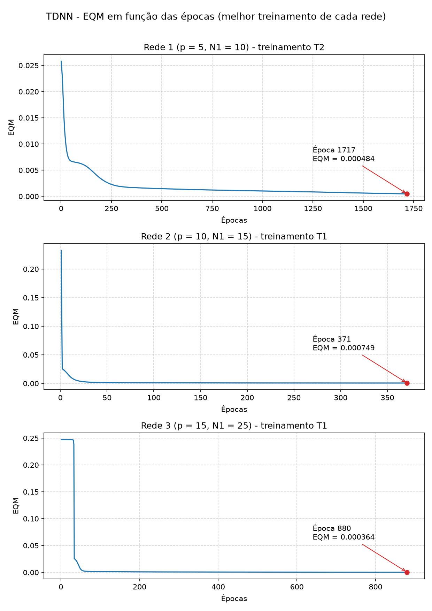
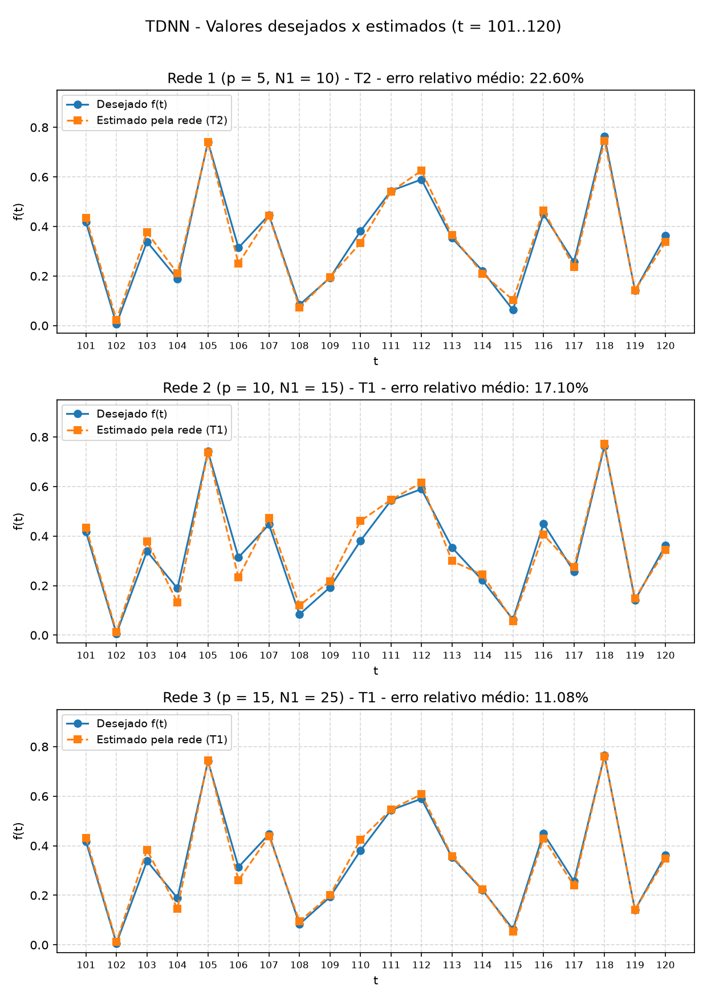

## Questão 1 – Configuração dos treinamentos

Foram executados 3 treinamentos (T1, T2 e T3) para cada uma das três topologias candidatas de rede Perceptron Multicamadas com topologia Time Delay (TDNN), totalizando 9 treinamentos, com os 100 valores da série do Anexo.

| Topologia | Entradas (p) | Neurônios escondidos (N1) | Neurônios de saída | Padrões de treinamento |
|:---------:|:------------:|:-------------------------:|:------------------:|:----------------------:|
| Rede 1 | 5  | 10 | 1 | 95 |
| Rede 2 | 10 | 15 | 1 | 90 |
| Rede 3 | 15 | 25 | 1 | 85 |

- Entradas da rede: os p valores anteriores da série, x1 = x(t−1), x2 = x(t−2), ..., xp = x(t−p), com saída desejada f(t). Os padrões são montados com uma janela deslizante, e por isso a quantidade de padrões é 100 − p.
- Algoritmo: backpropagation com momentum, W(t+1) = W(t) + α · (W(t) − W(t−1)) + η · δ · entrada.
- Função de ativação: logística (sigmoide), em todos os neurônios.
- Taxa de aprendizagem η = 0,1; fator de momentum α = 0,8; precisão ε = 0,5 × 10⁻⁶.
- Pesos iniciais: valores aleatórios entre 0 e 1, com o gerador de números aleatórios reiniciado com uma semente diferente em cada treinamento (sementes 1, 2 e 3 para T1, T2 e T3).

## Questão 2 – Resultados dos treinamentos

| Treinamento | Rede 1 – EQM | Rede 1 – Épocas | Rede 2 – EQM | Rede 2 – Épocas | Rede 3 – EQM | Rede 3 – Épocas |
|:-----------:|:------------:|:---------------:|:------------:|:---------------:|:------------:|:---------------:|
| 1º (T1) | 0.001018 | 969  | 0.000749 | 371 | 0.000364 | 880 |
| 2º (T2) | 0.000484 | 1717 | 0.000778 | 331 | 0.000623 | 580 |
| 3º (T3) | 0.001112 | 881  | 0.000695 | 399 | 0.000568 | 675 |

As redes com mais entradas e neurônios tendem a atingir EQM menores, com destaque para a Rede 3 (T1), que obteve o menor erro de todos os treinamentos (0,000364). A Rede 1 apresentou a maior variação entre os treinamentos, tanto no EQM final (de 0,000484 a 0,001112) quanto no número de épocas (de 881 a 1717).

## Questão 3 – Validação (t = 101..120)

A validação foi feita por previsão de um passo à frente: para estimar f(t), cada rede recebe os p valores reais anteriores da série. Erro relativo de cada amostra: |d − y_rede| / |d| × 100.

| Amostra | f(t) | Rede 1 (T1) | Rede 1 (T2) | Rede 1 (T3) | Rede 2 (T1) | Rede 2 (T2) | Rede 2 (T3) | Rede 3 (T1) | Rede 3 (T2) | Rede 3 (T3) |
|:-------:|:----:|:-----------:|:-----------:|:-----------:|:-----------:|:-----------:|:-----------:|:-----------:|:-----------:|:-----------:|
| t = 101 | 0.4173 | 0.4617 | 0.4351 | 0.4708 | 0.4343 | 0.4403 | 0.4309 | 0.4314 | 0.4326 | 0.4328 |
| t = 102 | 0.0062 | 0.0236 | 0.0234 | 0.0238 | 0.0135 | 0.0138 | 0.0158 | 0.0123 | 0.0111 | 0.0133 |
| t = 103 | 0.3387 | 0.3804 | 0.3763 | 0.3967 | 0.3795 | 0.3731 | 0.3761 | 0.3837 | 0.4000 | 0.3869 |
| t = 104 | 0.1886 | 0.2495 | 0.2104 | 0.2500 | 0.1320 | 0.1317 | 0.1377 | 0.1465 | 0.1390 | 0.1411 |
| t = 105 | 0.7418 | 0.7287 | 0.7403 | 0.7012 | 0.7370 | 0.7459 | 0.7413 | 0.7445 | 0.7580 | 0.7532 |
| t = 106 | 0.3138 | 0.1979 | 0.2506 | 0.1864 | 0.2326 | 0.2313 | 0.2254 | 0.2606 | 0.2368 | 0.2338 |
| t = 107 | 0.4466 | 0.4211 | 0.4428 | 0.4114 | 0.4735 | 0.4668 | 0.4666 | 0.4386 | 0.4556 | 0.4485 |
| t = 108 | 0.0835 | 0.0785 | 0.0729 | 0.0943 | 0.1199 | 0.1226 | 0.1087 | 0.0948 | 0.1000 | 0.0922 |
| t = 109 | 0.1930 | 0.2204 | 0.1960 | 0.2143 | 0.2172 | 0.2260 | 0.2222 | 0.1999 | 0.2025 | 0.2077 |
| t = 110 | 0.3807 | 0.2993 | 0.3333 | 0.2966 | 0.4608 | 0.4602 | 0.4546 | 0.4247 | 0.4583 | 0.4419 |
| t = 111 | 0.5438 | 0.5483 | 0.5409 | 0.5636 | 0.5463 | 0.5486 | 0.5466 | 0.5463 | 0.5418 | 0.5350 |
| t = 112 | 0.5897 | 0.6510 | 0.6250 | 0.6570 | 0.6154 | 0.6167 | 0.6254 | 0.6079 | 0.6301 | 0.6286 |
| t = 113 | 0.3536 | 0.3796 | 0.3644 | 0.3652 | 0.2992 | 0.2988 | 0.3049 | 0.3577 | 0.3417 | 0.3416 |
| t = 114 | 0.2210 | 0.1996 | 0.2099 | 0.2094 | 0.2439 | 0.2426 | 0.2461 | 0.2239 | 0.2524 | 0.2267 |
| t = 115 | 0.0631 | 0.1436 | 0.1034 | 0.1444 | 0.0572 | 0.0534 | 0.0557 | 0.0542 | 0.0508 | 0.0554 |
| t = 116 | 0.4499 | 0.4313 | 0.4654 | 0.4192 | 0.4051 | 0.4055 | 0.4059 | 0.4300 | 0.4204 | 0.4234 |
| t = 117 | 0.2564 | 0.2410 | 0.2361 | 0.2442 | 0.2744 | 0.2759 | 0.2691 | 0.2391 | 0.2634 | 0.2547 |
| t = 118 | 0.7642 | 0.7691 | 0.7459 | 0.7778 | 0.7714 | 0.7699 | 0.7704 | 0.7614 | 0.7536 | 0.7484 |
| t = 119 | 0.1411 | 0.1375 | 0.1420 | 0.1331 | 0.1491 | 0.1491 | 0.1454 | 0.1408 | 0.1567 | 0.1581 |
| t = 120 | 0.3626 | 0.3181 | 0.3377 | 0.3289 | 0.3430 | 0.3455 | 0.3498 | 0.3487 | 0.3432 | 0.3508 |
| **Erro Relativo Médio (%)** | | **30.18** | **22.60** | **31.39** | **17.10** | **17.93** | **17.92** | **11.08** | **13.64** | **13.46** |
| **Variância (%)** | | **4039.86** | **3600.87** | **4111.94** | **642.08** | **695.37** | **1057.40** | **448.79** | **296.38** | **587.17** |

O erro relativo médio diminui à medida que a topologia aumenta: a Rede 3 foi a melhor nos três treinamentos, seguida da Rede 2 e da Rede 1. Mais valores passados na janela de entrada permitem que a rede capture melhor o comportamento da série.

As variâncias elevadas são causadas principalmente pela amostra t = 102, cujo valor desejado (0,0062) é muito próximo de zero. Como o erro relativo divide pelo valor desejado, mesmo um erro absoluto pequeno se torna grande nessa amostra: na Rede 1, por exemplo, uma diferença de cerca de 0,017 corresponde a um erro relativo de aproximadamente 280%. Ainda assim, essa amostra afeta todas as redes, e a ordem de desempenho entre as topologias se mantém.

## Questão 4 – Gráficos do EQM por época (melhor treinamento de cada rede)

O melhor treinamento de cada topologia foi escolhido pelo menor erro relativo médio na validação: Rede 1 → T2, Rede 2 → T1 e Rede 3 → T1.

Nas três redes, o EQM cai rapidamente nas primeiras épocas e depois se estabiliza, até a variação entre épocas consecutivas ficar abaixo de ε. A Rede 1 (T2) precisou de mais épocas (1717) e continuou diminuindo lentamente até o final. A Rede 2 (T1) convergiu mais rápido (371 épocas). Na Rede 3 (T1), o EQM permaneceu estável em torno de 0,25 por aproximadamente 30 épocas antes de cair bruscamente: trata-se de um platô na superfície de erro, causado pela saturação dos neurônios no início do treinamento (pesos iniciais entre 0 e 1 em uma rede maior). O termo de momentum ajudou a rede a sair dessa região.

## Questão 5 – Valores desejados x estimados (t = 101..120)

As três redes acompanham o comportamento geral da série, inclusive os picos em t = 105 e t = 118. A Rede 1 apresenta os maiores desvios, como em t = 106, t = 110 e t = 115. A Rede 2 melhora a aproximação, mas ainda erra em pontos como t = 104, t = 106 e t = 110. A Rede 3 é a que mais se aproxima dos valores desejados, com a curva estimada praticamente sobreposta à curva real na maior parte dos pontos.

## Questão 6 – Topologia e treinamento mais adequados

A configuração mais adequada para realizar previsões neste processo é a **Rede 3 (p = 15, N1 = 25) com o treinamento T1**, pois:

- apresentou o **menor erro relativo médio** na validação entre todos os 9 treinamentos (11,08%);
- obteve também o **menor EQM de treinamento** (0,000364);
- foi a que melhor acompanhou os valores desejados no gráfico da Questão 5.

O T2 da Rede 3 teve a menor variância (296,38%), mas um erro médio maior (13,64%). Como o objetivo é prever com a maior precisão possível, o erro relativo médio foi o critério principal. Além disso, a Rede 3 foi a melhor topologia nos três treinamentos, o que indica que o resultado não depende de uma inicialização favorável, mas da própria arquitetura: uma janela maior de valores passados fornece mais informação sobre o comportamento da série.

## Questão 7 – Variantes do algoritmo backpropagation

### a. Resilient-Propagation (RProp)

Proposto por Riedmiller e Braun (1993), o RProp modifica a forma como os pesos são ajustados: em vez de usar o valor do gradiente, usa **apenas o seu sinal** para definir a direção do ajuste. O tamanho do passo é controlado por um valor de atualização individual para cada peso, que se adapta durante o treinamento:

- se o sinal da derivada se mantém entre duas iterações, o passo aumenta (tipicamente multiplicado por 1,2), acelerando a descida;
- se o sinal muda, indicando que o mínimo foi ultrapassado, o passo diminui (tipicamente multiplicado por 0,5);
- os passos são limitados por valores mínimo e máximo.

**Principais vantagens:**
- Elimina o problema dos gradientes muito pequenos em regiões de saturação da função logística, já que a magnitude do gradiente não influencia o tamanho do passo.
- Convergência significativamente mais rápida que o backpropagation padrão e com momentum.
- Não depende de uma boa escolha da taxa de aprendizagem, e seus parâmetros padrão funcionam bem na maioria dos problemas.
- Baixo custo computacional e de memória, semelhante ao backpropagation.

### b. Levenberg-Marquardt (LM)

O algoritmo de Levenberg-Marquardt, aplicado ao treinamento de redes neurais por Hagan e Menhaj (1994), é um método de **segunda ordem** que aproxima o método de Newton sem precisar calcular a matriz Hessiana. Ele usa a matriz Jacobiana J (derivadas dos erros em relação aos pesos) e ajusta os pesos por:

W ← W − (JᵀJ + μI)⁻¹ Jᵀe

O parâmetro μ controla o comportamento do algoritmo: quando μ é grande, ele se comporta como a descida do gradiente (passos pequenos e seguros); quando μ é pequeno, se aproxima do método de Gauss-Newton (passos rápidos perto do mínimo). O valor de μ é diminuído quando o erro cai e aumentado quando o erro sobe.

**Principais vantagens:**
- É um dos algoritmos mais rápidos para redes de pequeno e médio porte, convergindo em muito menos épocas que o backpropagation.
- Atinge erros finais muito baixos, sendo especialmente indicado para problemas de aproximação de funções e previsão de séries temporais, como o deste trabalho.
- Combina a estabilidade da descida do gradiente com a velocidade do método de Gauss-Newton.

**Limitação:** exige o cálculo da Jacobiana e a inversão de uma matriz cujo tamanho é igual ao número de pesos da rede. Por isso, o consumo de memória e o custo computacional por iteração crescem muito em redes grandes.
