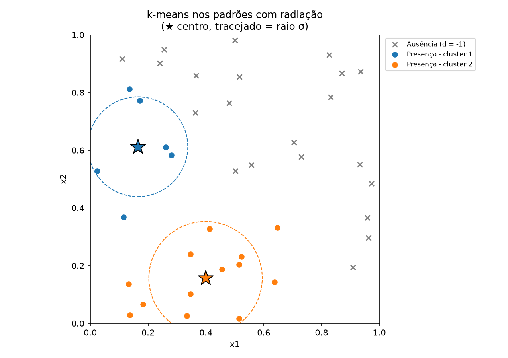
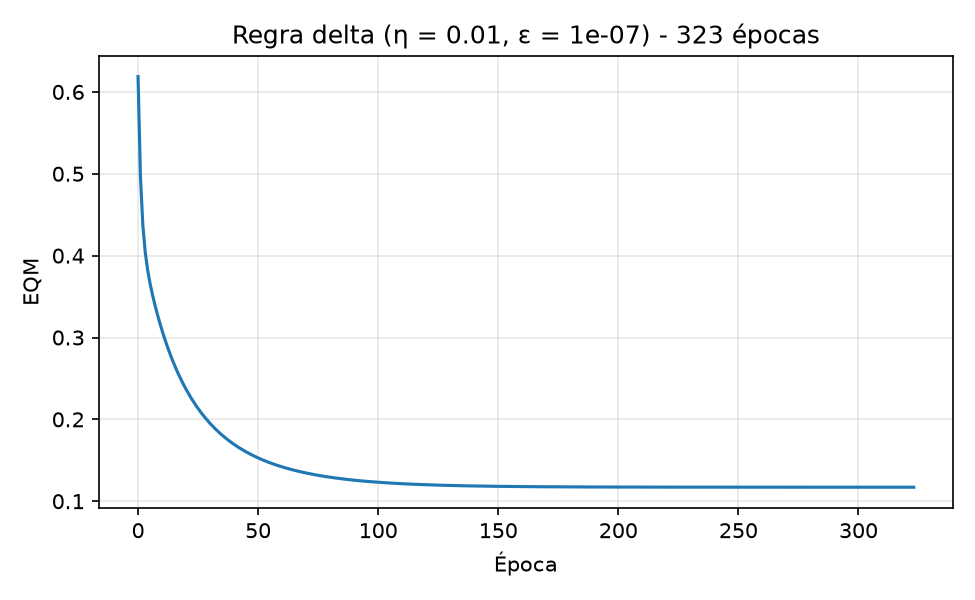
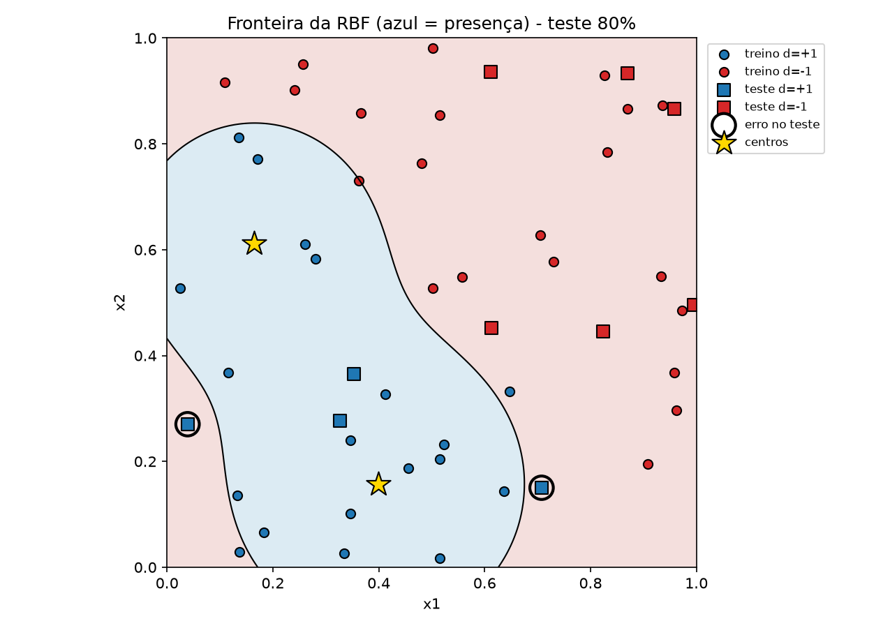

# Trabalho – Rede RBF

**Aluno:** João Pedro Marques Lopes Padilha

---

## 1. Centros e variâncias (*k-means*)

O *k-means* (k = 2) foi aplicado apenas às 19 amostras com presença de radiação (d = +1). Para cada cluster, a variância é a média das distâncias ao quadrado entre as amostras e o centro:

```
σ²ₖ = (1 / nₖ) · Σ ‖x − cₖ‖²
```

onde nₖ é o número de amostras do cluster k e a soma percorre essas amostras.

| Cluster | Centro (x₁ ; x₂) | Variância |
|:---:|:---:|:---:|
| 1 | (0,1648 ; 0,6121) | 0,0298 |
| 2 | (0,3990 ; 0,1571) | 0,0385 |



---

## 2. Pesos da camada de saída (regra delta generalizada)

O treinamento foi feito com η = 0,01 e ε = 10⁻⁷. A rede convergiu em **323 épocas**, com EQM final de **0,117121**.

| Peso | Valor |
|:---:|:---:|
| W2₁,₀ | 1,0019 |
| W2₁,₁ | 2,3751 |
| W2₁,₂ | 2,6965 |

Função aprendida, com o limiar aplicado sobre uma entrada fixa de −1:

```
y  = −1,0019 + 2,3751·φ₁ + 2,6965·φ₂

φₖ = exp( −‖x − cₖ‖² / (2σ²ₖ) )
```



---

## 3. Pós-processamento (função sinal)

```python
def sinal(y):
    return np.where(y >= 0, 1, -1)

y     = entrada_saida(X_teste, centros, variancias) @ W   # saída real da rede
y_pos = sinal(y)                                          # saída inteira (±1)
```

---

## 4. Validação

| Amostra | x₁ | x₂ | d | y | y pós |
|:---:|:---:|:---:|:---:|:---:|:---:|
| 1 | 0,8705 | 0,9329 | −1 | −1,0018 | −1 |
| 2 | 0,0388 | 0,2703 | 1 | −0,3229 | −1 |
| 3 | 0,8236 | 0,4458 | −1 | −0,9134 | −1 |
| 4 | 0,7075 | 0,1502 | 1 | −0,2197 | −1 |
| 5 | 0,9587 | 0,8663 | −1 | −1,0018 | −1 |
| 6 | 0,6115 | 0,9365 | −1 | −0,9871 | −1 |
| 7 | 0,3534 | 0,3646 | 1 | 0,9660 | 1 |
| 8 | 0,3268 | 0,2766 | 1 | 1,3227 | 1 |
| 9 | 0,6129 | 0,4518 | −1 | −0,4677 | −1 |
| 10 | 0,9948 | 0,4962 | −1 | −0,9959 | −1 |
| **Taxa de acerto (%)** | | | | | **80%** |

A rede errou duas amostras, a 2 e a 4. As duas têm radiação, mas foram classificadas como ausência. Ambas estão longe dos dois centros: cerca de 2σ no caso da amostra 2 e 1,6σ no caso da amostra 4. Por isso as gaussianas respondem pouco e a saída fica negativa.



---

## 5. Estratégias para aumentar a taxa de acerto

Os erros vêm de a região de presença ser coberta por apenas duas gaussianas estreitas (σ ≈ 0,17 a 0,20). Com isso, amostras na borda dessa região ficam de fora. Cada estratégia abaixo foi testada mantendo o mesmo procedimento e os mesmos conjuntos de treino e teste:

| Estratégia | Configuração | Acerto treino | Acerto teste |
|---|---|:---:|:---:|
| Rede original | k = 2 | 92,5% | 80% |
| Mais neurônios | k = 4 | 92,5% | 70% |
| | k = 5 | 95,0% | 60% |
| | k = 7 | 100% | 60% |
| Gaussianas mais largas | σ² × 2 | 92,5% | 90% |
| Centros também na classe −1 | 1 + 1 neurônios | 95,0% | 100% |
| | 2 + 2 neurônios | 97,5% | 100% |
| Perceptron simples (reta) | — | 100% | 100% |

- **Aumentar o número de neurônios não resolve.** O acerto no treino sobe até 100%, mas o do teste cai para 60–70%. É overfitting: as gaussianas ficam muito estreitas e a rede decora as amostras de treino. Por isso, o número de neurônios deve ser escolhido por validação cruzada.
- **Alargar as gaussianas** faz elas alcançarem os pontos de borda, e o acerto no teste sobe para 90%. A largura pode ser definida por regras como σ = dₘₐₓ / √(2k) ou pela distância média entre os centros, em vez de usar a variância do cluster.
- **Posicionar centros também nas amostras sem radiação** dá à rede referências das duas classes. Com apenas 1 + 1 neurônios, o acerto no teste chega a 100%.
- **Usar um modelo mais simples também resolve:** os dados são linearmente separáveis, e um perceptron simples acerta 100% do treino e do teste.
- **Ampliar o conjunto de treinamento** ajuda, principalmente com amostras nas bordas da região de presença.
- **Ajustar centros e variâncias de forma supervisionada** é outra opção: aplicar gradiente descendente também na camada escondida, em vez de mantê-la fixa depois do k-means.

O conjunto de teste tem apenas 10 amostras, então cada uma vale 10 pontos percentuais. Para comparar as estratégias com mais segurança, o ideal é usar validação cruzada.
