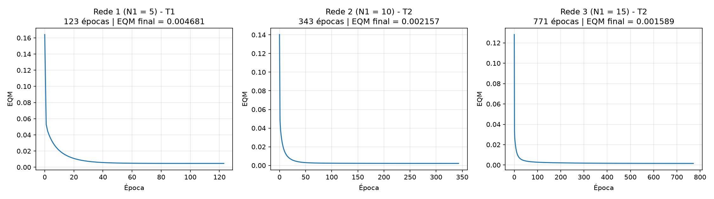
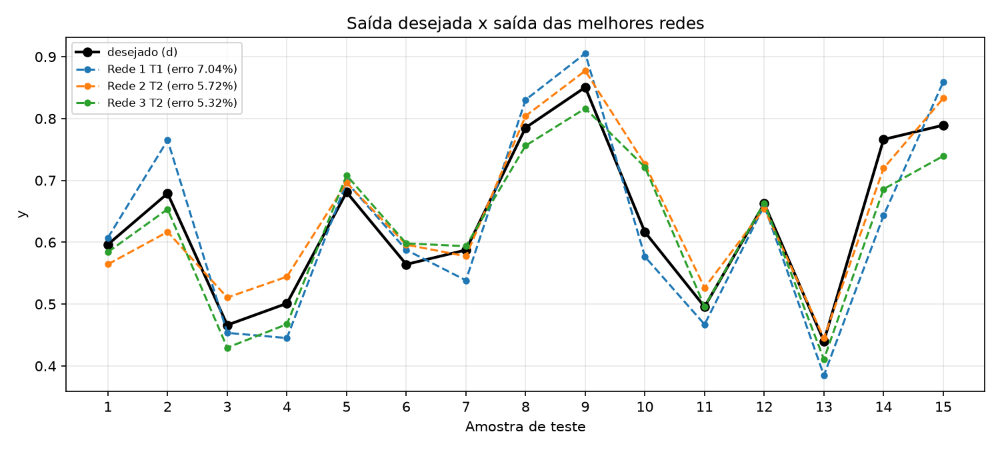

# Trabalho – RBF para Aproximação Funcional (Injeção Eletrônica)

**Aluno:** João Pedro Marques Lopes Padilha

---

## 1. Treinamentos

Cada topologia foi treinada 3 vezes:

| Rede | Neurônios na camada escondida (N1) |
|:---:|:---:|
| Rede 1 | 5 |
| Rede 2 | 10 |
| Rede 3 | 15 |

**Camada escondida (k-means):** o *k-means* foi aplicado às **150 amostras de treinamento**. Por ser um problema de aproximação de função, não há classes para separar. A variância de cada neurônio é a média das distâncias ao quadrado entre as amostras do cluster e o seu centro:

```
σ²ₖ = (1 / nₖ) · Σ ‖x − cₖ‖²

φₖ(x) = exp( −‖x − cₖ‖² / (2σ²ₖ) )
```

**Camada de saída (regra delta generalizada):**

- Taxa de aprendizado: η = 0,01
- Precisão: ε = 10⁻⁷ (o treino para quando |EQM_atual − EQM_anterior| ≤ ε)
- Pesos iniciais: aleatórios entre 0 e 1. O gerador de números aleatórios foi reiniciado com uma semente diferente em cada treinamento (T1 = 1, T2 = 2, T3 = 3), para que as matrizes iniciais não se repetissem.

Exemplo dos três primeiros pesos iniciais de cada treinamento:

| Treinamento | W2₁,₀ | W2₁,₁ | W2₁,₂ |
|:---:|:---:|:---:|:---:|
| T1 | 0,5118 | 0,9505 | 0,1442 |
| T2 | 0,2616 | 0,2985 | 0,8142 |
| T3 | 0,0856 | 0,2368 | 0,8013 |

---

## 2. Resultados dos treinamentos

| Treinamento | Rede 1 – EQM | Rede 1 – Épocas | Rede 2 – EQM | Rede 2 – Épocas | Rede 3 – EQM | Rede 3 – Épocas |
|:---:|:---:|:---:|:---:|:---:|:---:|:---:|
| 1º (T1) | 0,0046805 | 123 | 0,0021567 | 432 | 0,0015895 | 867 |
| 2º (T2) | 0,0046806 | 127 | 0,0021567 | 343 | 0,0015894 | 771 |
| 3º (T3) | 0,0046806 | 118 | 0,0021567 | 359 | 0,0015895 | 830 |

**Mais neurônios, menor EQM.** O EQM cai à medida que N1 aumenta: de 0,00468 com 5 neurônios para 0,00159 com 15. Por outro lado, a convergência fica mais lenta (de cerca de 120 para cerca de 800 épocas).

**Os três treinamentos de cada rede chegam ao mesmo EQM.** Dentro de uma mesma rede, o EQM praticamente não muda entre T1, T2 e T3; só o número de épocas varia. Isso é esperado na RBF: depois do k-means, os centros e as variâncias ficam fixos, e a saída passa a ser uma combinação **linear** dos φ. O erro dessa combinação tem um único mínimo. Assim, qualquer conjunto de pesos iniciais converge para o mesmo ponto, apenas por caminhos de tamanhos diferentes.

---

## 3. Validação

| Amostra | x₁ | x₂ | x₃ | d | Rede 1 y(T1) | Rede 1 y(T2) | Rede 1 y(T3) | Rede 2 y(T1) | Rede 2 y(T2) | Rede 2 y(T3) | Rede 3 y(T1) | Rede 3 y(T2) | Rede 3 y(T3) |
|:---:|:---:|:---:|:---:|:---:|:---:|:---:|:---:|:---:|:---:|:---:|:---:|:---:|:---:|
| 01 | 0,5102 | 0,7464 | 0,0860 | 0,5965 | 0,6074 | 0,6074 | 0,6074 | 0,5645 | 0,5645 | 0,5645 | 0,5843 | 0,5843 | 0,5843 |
| 02 | 0,8401 | 0,4490 | 0,2719 | 0,6790 | 0,7651 | 0,7652 | 0,7651 | 0,6169 | 0,6169 | 0,6169 | 0,6535 | 0,6535 | 0,6535 |
| 03 | 0,1283 | 0,1882 | 0,7253 | 0,4662 | 0,4536 | 0,4531 | 0,4534 | 0,5107 | 0,5107 | 0,5107 | 0,4296 | 0,4296 | 0,4296 |
| 04 | 0,2299 | 0,1524 | 0,7353 | 0,5012 | 0,4452 | 0,4448 | 0,4450 | 0,5444 | 0,5444 | 0,5444 | 0,4676 | 0,4676 | 0,4676 |
| 05 | 0,3209 | 0,6229 | 0,5233 | 0,6810 | 0,6973 | 0,6973 | 0,6973 | 0,6963 | 0,6963 | 0,6963 | 0,7083 | 0,7083 | 0,7083 |
| 06 | 0,8203 | 0,0682 | 0,4260 | 0,5643 | 0,5876 | 0,5883 | 0,5880 | 0,5962 | 0,5962 | 0,5962 | 0,5982 | 0,5982 | 0,5982 |
| 07 | 0,3471 | 0,8889 | 0,1564 | 0,5875 | 0,5384 | 0,5386 | 0,5385 | 0,5774 | 0,5774 | 0,5774 | 0,5937 | 0,5937 | 0,5937 |
| 08 | 0,5762 | 0,8292 | 0,4116 | 0,7853 | 0,8304 | 0,8300 | 0,8302 | 0,8042 | 0,8042 | 0,8042 | 0,7563 | 0,7563 | 0,7563 |
| 09 | 0,9053 | 0,6245 | 0,5264 | 0,8506 | 0,9054 | 0,9050 | 0,9052 | 0,8773 | 0,8773 | 0,8773 | 0,8164 | 0,8164 | 0,8164 |
| 10 | 0,8149 | 0,0396 | 0,6227 | 0,6165 | 0,5767 | 0,5774 | 0,5770 | 0,7262 | 0,7262 | 0,7262 | 0,7216 | 0,7216 | 0,7216 |
| 11 | 0,1016 | 0,6382 | 0,3173 | 0,4957 | 0,4672 | 0,4673 | 0,4673 | 0,5264 | 0,5264 | 0,5264 | 0,4961 | 0,4961 | 0,4961 |
| 12 | 0,9108 | 0,2139 | 0,4641 | 0,6625 | 0,6592 | 0,6598 | 0,6595 | 0,6547 | 0,6547 | 0,6547 | 0,6634 | 0,6634 | 0,6634 |
| 13 | 0,2245 | 0,0971 | 0,6136 | 0,4402 | 0,3848 | 0,3842 | 0,3845 | 0,4452 | 0,4452 | 0,4452 | 0,4109 | 0,4109 | 0,4109 |
| 14 | 0,6423 | 0,3229 | 0,8567 | 0,7663 | 0,6433 | 0,6435 | 0,6433 | 0,7196 | 0,7196 | 0,7196 | 0,6860 | 0,6860 | 0,6860 |
| 15 | 0,5252 | 0,6529 | 0,5729 | 0,7893 | 0,8592 | 0,8590 | 0,8591 | 0,8329 | 0,8329 | 0,8329 | 0,7395 | 0,7395 | 0,7395 |
| **Erro Relativo Médio (%)** | | | | | 7,04 | 7,05 | 7,05 | 5,72 | 5,72 | 5,72 | 5,33 | 5,32 | 5,33 |
| **Variância (%)** | | | | | 19,26 | 19,37 | 19,31 | 17,89 | 17,89 | 17,89 | 17,83 | 17,83 | 17,83 |

Como as métricas foram calculadas:

- **Erro relativo de cada amostra:** |d − y| / d × 100.
- **Erro relativo médio:** a média desses erros nas 15 amostras.
- **Variância:** a variância desses mesmos erros percentuais.

O que a tabela mostra:

- **O erro cai à medida que a rede cresce:** 7,04% na Rede 1, 5,72% na Rede 2 e 5,32% na Rede 3.
- **A variância segue a mesma tendência.** Ou seja, além de errar menos em média, as redes maiores erram de forma mais uniforme entre as amostras.
- **Os maiores erros individuais aparecem em amostras diferentes:**
  - Rede 1: amostra 14 (≈ 16%) e amostra 2 (≈ 12,7%).
  - Redes 2 e 3: amostra 10 (≈ 17–18%).

---

## 4. EQM por época (melhor treinamento de cada topologia)

O melhor treinamento de cada rede foi escolhido pelo menor erro relativo médio na validação:

| Rede | Melhor treinamento | EQM | Épocas | Erro relativo médio (%) |
|:---:|:---:|:---:|:---:|:---:|
| Rede 1 | T1 | 0,0046805 | 123 | 7,04 |
| Rede 2 | T2 | 0,0021567 | 343 | 5,72 |
| Rede 3 | T2 | 0,0015894 | 771 | 5,32 |



As três curvas têm o mesmo formato: uma queda brusca nas primeiras épocas, seguida de uma longa fase de ajuste fino até atingir a precisão ε. Quanto mais neurônios, menor o EQM final e mais épocas são necessárias para estabilizar.

---

## 5. Topologia e treinamento mais adequados

**A topologia mais adequada é a Rede 3 (N1 = 15), com a configuração do treinamento T2.**

Ela apresentou os melhores resultados em todos os critérios:

- **Menor EQM no treinamento:** 0,0015894.
- **Menor erro relativo médio na validação:** 5,32%.
- **Menor variância do erro:** 17,83.



**Sobre a escolha do treinamento:** dentro de cada topologia, a diferença entre T1, T2 e T3 é desprezível (menos de 0,01 ponto percentual no erro). Isso acontece porque, como explicado na questão 2, a camada de saída converge para o mesmo mínimo qualquer que seja o peso inicial. Por isso, a escolha da topologia é o que realmente importa. Entre os treinamentos da Rede 3, o T2 foi marginalmente melhor e também o que convergiu em menos épocas (771).

**Sobre o ganho de cada aumento de neurônios:** o ganho diminui a cada aumento de N1.

| Mudança | Queda no erro de validação | Queda no EQM |
|---|:---:|:---:|
| De 5 para 10 neurônios | ≈ 1,3 ponto percentual (7,04% → 5,72%) | 54% |
| De 10 para 15 neurônios | ≈ 0,4 ponto percentual (5,72% → 5,32%) | 26% |

Ainda assim, a Rede 3 continua melhorando também na validação, e não só no treinamento. Portanto, não há sinal de overfitting com 15 neurônios.
